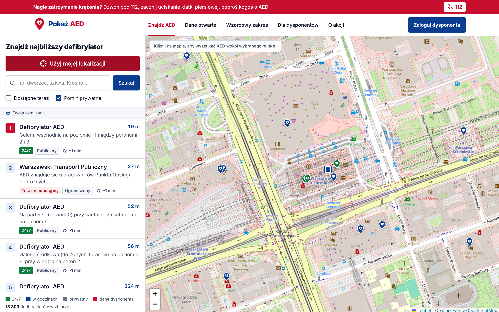

# Pokaż AED – dane na ratunek

**Misja AED · HackNation 2026 · Ministerstwo Cyfryzacji**

> *Pokaż AED. Każda minuta się liczy.* – rozwiązanie, które zbiera rozproszone dane o defibrylatorach AED, ujednolica je do **wzorcowego zakresu danych** i przygotowuje do **automatycznego importu w portalu dane.gov.pl**, a akcja „Pokaż AED” zachęca dysponentów do udostępniania danych.



## Co zawiera rozwiązanie

| Element | Gdzie |
|---|---|
| **Wzorcowy zakres danych** (XLSX – opis pól, słowniki, przykład, szablon z listami rozwijanymi) | [`schema/out/wzorcowy_zakres_danych_AED.xlsx`](schema/out/wzorcowy_zakres_danych_AED.xlsx) |
| Ten sam standard maszynowo: Frictionless Table Schema, JSON Schema, szablon CSV | [`schema/out/`](schema/out) · źródło prawdy: [`schema/aed_schema.yaml`](schema/aed_schema.yaml) |
| **Agregator** – integracja 5 źródeł (4 zbiory gmin z dane.gov.pl + OpenStreetMap), deduplikacja, ocena jakości | [`backend/aed/pipeline.py`](backend/aed/pipeline.py), [`backend/aed/sources.py`](backend/aed/sources.py) |
| **Uniwersalny walidator** plików dysponentów (CSV/XLSX/JSON/GeoJSON, auto-mapowanie kolumn, auto-poprawki) | [`backend/aed/validator.py`](backend/aed/validator.py) |
| **Eksport do dane.gov.pl** – XML harwestera `urn:otwarte-dane:harvester:1.13` walidowany względem oficjalnego XSD + DCAT-AP (JSON-LD) | [`backend/aed/publish.py`](backend/aed/publish.py), [`vendor/dane-gov-pl/`](vendor/dane-gov-pl) |
| **REST API** (OpenAPI) | `/api/docs` |
| **Aplikacja web** (WCAG 2.2, responsywna): mapa „Znajdź AED”, dane otwarte, standard, portal dysponenta, strona akcji | [`frontend/`](frontend) |
| **Logotyp** (SVG, PNG, JPG, PDF) i **księga znaku** (PDF) | [`branding/out/`](branding/out) |
| Zrzuty ekranu do prezentacji | [`docs/screenshots/`](docs/screenshots) |
| Plan, architektura i decyzje projektowe | [`docs/PLAN.md`](docs/PLAN.md) |

## Najważniejsze liczby (stan danych z 20.11.2026)

- **18 309** defibrylatorów w zbiorze zintegrowanym, przypisanych do 16 województw.
- Tylko **74** pochodzi z oficjalnych danych dysponentów w dane.gov.pl (Krosno, Marki, Legionowo, Przemyśl). **58** z nich potwierdziliśmy krzyżowo w OpenStreetMap.
- **63%** urządzeń nie ma informacji o godzinach dostępności, a **67%** nie ma przypisanego dysponenta. To główne luki, które ma zamknąć akcja.

## Kroki użytkownika

**Świadek zdarzenia / ratownik (`/`)**
1. Klika **„Użyj mojej lokalizacji”** albo wskazuje punkt na mapie lub wyszukuje miejsce.
2. Dostaje listę najbliższych AED z odległością, czasem dojścia i statusem „24/7 / dostępny teraz / niedostępny”.
3. Otwiera szczegóły: dokładne miejsce zawieszenia, godziny, dostęp, szafka, dysponent. Klika **„Prowadź”** (nawigacja piesza) lub **„Dzwoń 112”**.
4. Może **zgłosić problem** (zamknięty, brak urządzenia, uszkodzony) albo **potwierdzić AED**.

**Dysponent danych (`/dysponent`)**
1. Wgrywa plik, który już ma, w dowolnym układzie kolumn. Konto nie jest potrzebne do samego sprawdzenia.
2. Dostaje raport: zgodność w %, błędy i ostrzeżenia z numerem wiersza, automatyczne poprawki (np. zamienione współrzędne, formaty dat i kodów pocztowych, wiersze ujęte w cudzysłów).
3. Uzupełnia brakujące pola obowiązkowe jedną wartością dla całego pliku i pobiera plik w wzorcowym zakresie.
4. Po zalogowaniu (formularze mają przełącznik widoczności hasła) publikuje zbiór. Dostaje **stały URL zasobu CSV** i **XML harwestera do zarejestrowania w dane.gov.pl**, a portal sam pobiera kolejne aktualizacje.
5. W sekcji **„Znajdź swoje AED”** odnajduje urządzenia zmapowane przez wolontariuszy OSM, żeby je potwierdzić.

**Integrator / portal (`/dane`, `/api/docs`)**: pobiera zbiór w CSV, XLSX, JSON lub GeoJSON albo korzysta z API (wyszukiwanie, najbliższe AED, filtrowanie, bbox).

## Uruchomienie

Wymagania: Python 3.12+ i Node 20+.

```bash
make install
```

```bash
make schema data build
```

```bash
cd backend && uvicorn aed.api.main:app --port 8000
```

Aplikacja działa pod `http://localhost:8000`, dokumentacja API pod `http://localhost:8000/api/docs`.
Tryb deweloperski: `make api`, a w drugim terminalu `make web` (Vite na `:5173` z proxy do API).

Docker (nieprzetestowany w środowisku prototypu):

```bash
docker compose up --build
```

Testy (13: walidator na prawdziwych plikach z dane.gov.pl, XML vs oficjalny XSD, API, ścieżka dysponenta):

```bash
make test
```

## Zgodność z zasadami dane.gov.pl

- Formaty odczytywalne maszynowo: CSV (UTF-8, przecinek), JSON, GeoJSON, XLSX i XML. Nie używamy PDF ani DOC do udostępniania danych.
- Katalog w **oficjalnym formacie harwestera XML** (XSD 1.13 z kodu źródłowego portalu, `vendor/dane-gov-pl`). Test automatyczny sprawdza zgodność.
- Kategoria **HEAL (Zdrowie)**, słowa kluczowe, częstotliwość aktualizacji i licencje z listy portalu (CC0 1.0 / CC BY 4.0).
- **Licencje:** portal przyjmuje licencje CC, a dane OSM są na ODbL (share-alike). Dlatego do dane.gov.pl kierujemy **dane dysponentów**. OSM służy do weryfikacji, wskazania luk i typowania instytucji do zaproszenia. Pełny zbiór z OSM udostępniamy osobno, na ODbL.
- Dane osobowe: wzorcowy zakres przewiduje wyłącznie kontakty instytucjonalne (RODO).

## Ograniczenia prototypu

- Źródło m.st. Warszawy (dane.gov.pl, zbiór 39512) wskazuje na API `dane.um.warszawa.pl`, które było niedostępne z sieci prototypu. 113 rekordów OSM ma już powiązanie `ref:api-um-warszawa-pl`.
- Rekordy OSM często nie mają adresu ani miejscowości. Województwo wyznaczamy geometrycznie, a geokodowanie odwrotne (np. usługą GUGiK) to kolejny krok.
- Kod TERC w danych Legionowa ma 6 cyfr (brak cyfry rodzaju gminy). Walidator zgłasza ostrzeżenie zamiast zgadywać.
- Zgłoszenia obywateli i zbiory dysponentów trafiają do bazy SQLite. Brakuje jeszcze panelu moderacji i powiadomień e-mail do dysponentów.
- Konta dysponentów nie są weryfikowane (np. przez login.gov.pl lub węzeł krajowy). W docelowym wdrożeniu powinno to być wymagane.
- Kafelki mapy: publiczny serwer OpenStreetMap, dopuszczalny dla prototypu. W produkcji potrzebny jest własny serwer kafelków lub usługa komercyjna.

## Wykorzystanie sztucznej inteligencji (§2 ust. 8 regulaminu)

Zespół korzystał z asystenta AI (Claude) do:
- analizy treści zadania i regulaminu,
- generowania części kodu (backend, frontend, skrypty) oraz projektów SVG znaku i księgi znaku,
- wyszukania źródeł danych w API dane.gov.pl i schematu harwestera w kodzie źródłowym portalu.

Koncepcję rozwiązania, nazwę i hasło akcji, wybór zakresu danych, decyzje licencyjne oraz weryfikację i ostateczny kształt wszystkich elementów opracował i zatwierdził zespół. Szczegóły: [`docs/AI_USAGE.md`](docs/AI_USAGE.md).

## Licencje

- Kod: do ustalenia przez zespół (zgodnie z §4 regulaminu prawa majątkowe przechodzą na Ministra Cyfryzacji w przypadku wygranej).
- Dane: dane dysponentów – CC0 1.0 / CC BY 4.0 (wg źródła); zbiór zintegrowany – ODbL 1.0 (© współtwórcy OpenStreetMap).
- Krój Inter – SIL Open Font License 1.1. Granice województw – [ppatrzyk/polska-geojson](https://github.com/ppatrzyk/polska-geojson) (dane PRG GUGiK).
